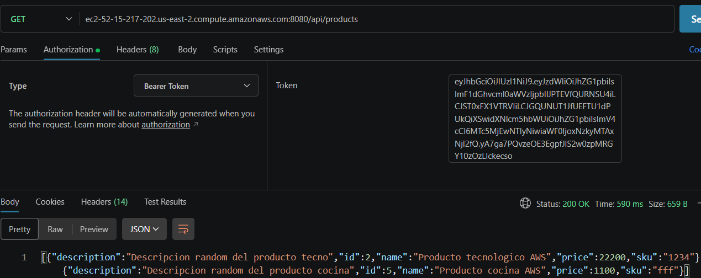

# Despliegue de Spring Boot en AWS EC2 y RDS

## 1. Descripción

Práctica guiada de despliegue de una aplicación backend desarrollada con Spring Boot en AWS usando la capa gratuita. Se genera un archivo JAR, se configura una base de datos MySQL en Amazon RDS y se ejecuta la aplicación en una instancia Linux de Amazon EC2.

## 2. Objetivos
- Empaquetar una api en Spring Boot con Maven.

- Configurar una base de datos MySQL en Amazon RDS.

- Conectarse de modo remoto a una instancia Linux mediante SSH.

- Hacer la transferencia de archivos al servidor mediante SCP.

- Ejecutar una API REST en EC2 y validar los endpoints con Postman.

- Gestionar y eliminar los recursos de AWS para evitar costos innecesarios.

## 2. Tecnologías y herramientas

<p>
  
  
  
  
  
  
  
  
</p>

- **Java 17 y Spring Boot:** aplicación backend empaquetada como JAR.
- **Maven Wrapper:** compilación y empaquetado del proyecto.
- **Amazon EC2:** máquina virtual Linux donde se ejecuta la aplicación.
- **Amazon RDS for MySQL:** base de datos relacional administrada.
- **OpenSSH Client:** una tecnologia que tiene los comandos **ssh** y **scp** para la conexión remota y transferencia del JAR.
- **MySQL Workbench:** conexión y migración de la base de datos.
- **Postman:** comprobación de los endpoints de la API.

## 3. Comandos destacados

Los siguientes ejemplos se deben adaptar al nombre real del archivo, la ubicación de la clave privada, el usuario Linux y la dirección de la instancia.

### Empaquetar la aplicación

Desde la carpeta raíz del proyecto, en Linux/macOS/Git Bash:

```bash
./mvnw clean package
```

En PowerShell de Windows, normalmente se utiliza:

```powershell
.\mvnw.cmd clean package
```

El JAR generado se encuentra dentro de la carpeta `target/`.

### Ejecutar el JAR localmente o en EC2

```bash
java -jar ./target/spring-security-0.0.1-SNAPSHOT.jar
```

El nombre del archivo es el utilizado en los apuntes de esta práctica; puede variar según el proyecto y su versión.

### Conectarse a EC2 mediante SSH

Ejemplo para PowerShell en Windows:

```powershell
ssh -i "$HOME\Downloads\mi-clave.pem" ec2-user@TU_IP_PUBLICA
```

Reemplazar:
- `mi-clave.pem` por la ruta de la clave privada descargada.
- `ec2-user` por el usuario correspondiente a la imagen Linux.
- `TU_IP_PUBLICA` por la IP o el DNS público de la instancia.

### Copiar el JAR a EC2 mediante SCP

Ejemplo para PowerShell, ejecutado desde el equipo local:

```powershell
scp -i ".\ec2-backend.pem" ".\target\spring-security-0.0.1-SNAPSHOT.jar" ec2-user@TU_IP_PUBLICA:~
```

Este comando copia el JAR al directorio personal del usuario remoto. Adaptar las rutas y los datos de conexión al entorno real.

## 4. Procedimiento

### 1. Generar y probar el JAR localmente
- Verificar la versión de Java utilizada por el proyecto y el entorno.
- Empaquetar la aplicación con Maven Wrapper.
- Ejecutar el JAR localmente y comprobar la API con Postman.

### 2. Crear la base de datos en Amazon RDS
- Crear una instancia de MySQL en Amazon RDS.
- Configurar el nombre de la base de datos y las credenciales.
- Obtener el endpoint de RDS para configurar la conexión desde la aplicación.

### 3. Migrar la base de datos
- Configurar la conexión a RDS en `application.properties`.
- Ajustar las reglas de red necesarias para permitir la conexión desde MySQL Workbench.
- Exportar la base de datos local e importarla en RDS.
- Volver a generar el JAR para incorporar la configuración actualizada y probar la conexión.

### 4. Crear la instancia EC2
- Crear una instancia virtual con Linux.
- Generar y descargar un par de claves para la conexión SSH.
- Revisar el grupo de seguridad y los puertos requeridos por la práctica.

### 5. Conectarse al servidor y transferir el JAR
- Conectarse a EC2 desde PowerShell mediante SSH.
- Instalar Java JDK en la instancia.
- Copiar el archivo JAR desde el equipo local al servidor usando SCP.

### 6. Ejecutar y probar la aplicación en AWS
- Ejecutar el JAR en EC2.
- Acceder a la API mediante la dirección pública de la instancia y el puerto configurado.
- Probar los endpoints con Postman.
- Al finalizar el laboratorio, detener y eliminar los recursos de AWS que ya no sean necesarios para evitar cargos.


|Probando la api REST en AWS|
|:-------------------------:|
|